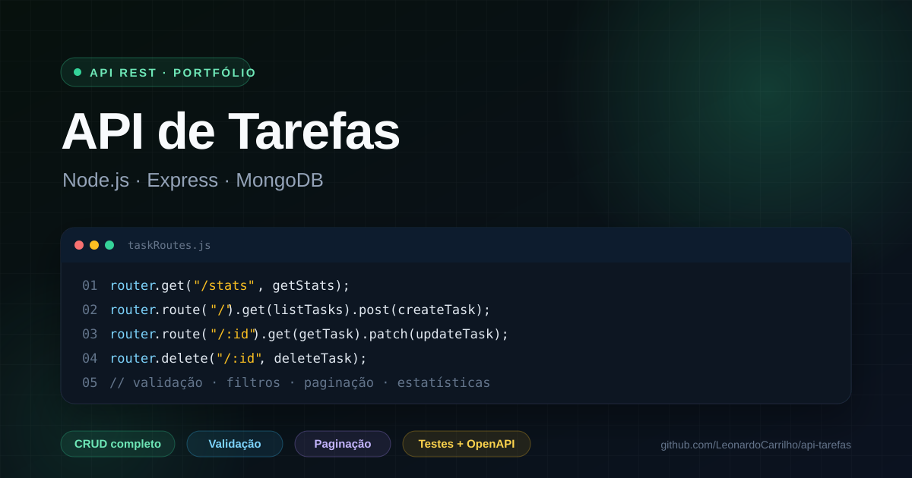

# API de Tarefas

Repositório: [github.com/LeonardoCarrilho/api-tarefas](https://github.com/LeonardoCarrilho/api-tarefas)

API REST para gerenciamento de tarefas, construída com **Node.js, Express e MongoDB (Mongoose)**. Inclui validação, filtros, busca, paginação, estatísticas, documentação OpenAPI e testes automatizados.




## Funcionalidades

- CRUD completo de tarefas
- Validação de título, status, prioridade e data
- Filtros por status, prioridade e busca textual
- Ordenação e paginação
- Estatísticas gerais (por status, prioridade, atrasadas e taxa de conclusão)
- `completedAt` atualizado automaticamente ao concluir uma tarefa
- CORS configurável, Helmet e logs com Morgan
- Documentação interativa com Swagger UI em `/api/docs`
- Contrato OpenAPI 3.0 disponível em `/api/docs.json`
- Testes de integração com Node Test Runner, Supertest e MongoDB em memória
- Seed com tarefas de exemplo
- Tratamento de erros de validação, ID inválido e JSON malformado

## Tecnologias

- Node.js + Express
- MongoDB + Mongoose
- dotenv, cors, helmet, morgan
- swagger-ui-express
- Node Test Runner, Supertest e mongodb-memory-server
- nodemon (desenvolvimento)

## Como rodar

### 1. Pré-requisitos

- Node.js 20.19 ou superior
- MongoDB local **ou** uma conta gratuita no [MongoDB Atlas](https://www.mongodb.com/atlas)

### 2. Instalação

```bash
npm install
cp .env.example .env
```

No Windows (PowerShell), use:

```powershell
Copy-Item .env.example .env
```

Edite o `.env` com a sua string de conexão:

```env
PORT=3000
MONGODB_URI=mongodb://127.0.0.1:27017/api-tarefas
NODE_ENV=development
```

### 3. Popular o banco (opcional)

```bash
npm run seed
```

> O seed **apaga as tarefas existentes** antes de inserir os dados de exemplo. Use apenas em desenvolvimento.

### 4. Iniciar a API

```bash
npm run dev
```

A API estará em `http://localhost:3000/api`. Teste o health check:

```bash
curl http://localhost:3000/api/health
```

A documentação interativa fica em [`http://localhost:3000/api/docs`](http://localhost:3000/api/docs). O contrato OpenAPI pode ser consumido em `http://localhost:3000/api/docs.json`.

## Endpoints

| Método | Rota | Descrição |
| --- | --- | --- |
| `GET` | `/api/health` | Status da API e do banco |
| `GET` | `/api/docs` | Documentação interativa (Swagger UI) |
| `GET` | `/api/docs.json` | Contrato OpenAPI 3.0 |
| `GET` | `/api/tasks` | Lista tarefas com filtros e paginação |
| `GET` | `/api/tasks/stats` | Estatísticas gerais |
| `GET` | `/api/tasks/:id` | Busca uma tarefa |
| `POST` | `/api/tasks` | Cria uma tarefa |
| `PUT` / `PATCH` | `/api/tasks/:id` | Atualiza uma tarefa |
| `DELETE` | `/api/tasks/:id` | Remove uma tarefa |

### Filtros da listagem

| Parâmetro | Valores | Padrão |
| --- | --- | --- |
| `status` | `pendente`, `em_andamento`, `concluida` | todos |
| `priority` | `baixa`, `media`, `alta` | todas |
| `search` | texto livre (título/descrição) | — |
| `sort` | `recent`, `oldest`, `due` | `recent` |
| `page` | número inteiro ≥ 1 | `1` |
| `limit` | 1 a 100 | `10` |

Exemplo:

```
GET /api/tasks?status=pendente&priority=alta&search=estudar&page=1&limit=5
```

### Criar tarefa

```http
POST /api/tasks
Content-Type: application/json

{
  "title": "Estudar Node.js",
  "description": "Revisar middlewares e tratamento de erros",
  "status": "pendente",
  "priority": "alta",
  "dueDate": "2026-11-05"
}
```

Resposta (`201`):

```json
{
  "data": {
    "title": "Estudar Node.js",
    "description": "Revisar middlewares e tratamento de erros",
    "status": "pendente",
    "priority": "alta",
    "dueDate": "2026-11-05T00:00:00.000Z",
    "completedAt": null,
    "createdAt": "2026-10-22T18:00:00.000Z",
    "updatedAt": "2026-10-22T18:00:00.000Z",
    "id": "6717f0c2c9d1b2a3e4f5a6b7"
  }
}
```

### Atualizar status

```http
PATCH /api/tasks/:id
Content-Type: application/json

{ "status": "concluida" }
```

Ao concluir, o campo `completedAt` é preenchido automaticamente. Ao reabrir, ele volta para `null`.

### Listagem paginada

```json
{
  "data": [],
  "meta": {
    "total": 42,
    "page": 1,
    "limit": 10,
    "pages": 5
  }
}
```

### Estatísticas

```json
{
  "data": {
    "total": 8,
    "overdue": 1,
    "completed": 2,
    "completionRate": 25,
    "byStatus": { "pendente": 4, "em_andamento": 2, "concluida": 2 },
    "byPriority": { "baixa": 1, "media": 4, "alta": 3 }
  }
}
```

## Estrutura

```
src/
├── config/
│   └── db.js               # conexão com o MongoDB
├── controllers/
│   └── taskController.js   # regras de negócio
├── docs/
│   └── openapi.js          # contrato OpenAPI 3.0
├── middlewares/
│   └── errorHandler.js     # 404 e erros centralizados
├── models/
│   └── Task.js             # schema e validações
├── routes/
│   └── taskRoutes.js       # rotas /api/tasks
├── scripts/
│   └── seed.js             # dados de exemplo
├── app.js                  # configuração do Express
└── server.js               # inicialização e shutdown
tests/
└── tasks.test.js           # testes de integração da API
docs/
└── preview.svg             # imagem de apresentação do repositório
```

## Testes

```bash
npm test
```

Os testes usam o **Node Test Runner** com **Supertest** e um MongoDB em memória (`mongodb-memory-server`), sem depender de um banco local. A suíte cobre health check, criação, validação, filtros, busca, paginação, estatísticas, atualização de status, remoção, erros de ID e a documentação OpenAPI.

Para rodar em modo watch:

```bash
npm run test:watch
```

### Testes manuais

Use o arquivo [`requests.http`](./requests.http) com a extensão **REST Client** do VS Code, ou importe as requisições no Insomnia/Postman. Também é possível testar com `curl`:

```bash
curl -X POST http://localhost:3000/api/tasks \
  -H "Content-Type: application/json" \
  -d '{"title":"Minha primeira tarefa","priority":"alta"}'
```

## Deploy

O repositório já inclui um **Blueprint do Render** em [`render.yaml`](./render.yaml) e um [`Dockerfile`](./Dockerfile) para executar em qualquer serviço de containers.

[](https://render.com/deploy?repo=https://github.com/LeonardoCarrilho/api-tarefas)

1. Crie um cluster gratuito no MongoDB Atlas e libere o IP do serviço (ou `0.0.0.0/0` para testes).
2. No Render, crie um **New Blueprint** apontando para este repositório.
3. Informe `MONGODB_URI` quando solicitado.
4. O Render usa `npm ci` como build e `npm start` como start. O health check é `/api/health`.
5. Ajuste `CORS_ORIGIN` para o domínio do front-end, se necessário.

### Docker

```bash
docker build -t api-tarefas .
docker run --env-file .env -p 3000:3000 api-tarefas
```

## Possíveis evoluções

- Autenticação com JWT e tarefas por usuário
- Rate limiting e cache de estatísticas
- Front-end consumindo a API
- WebSocket para atualizações em tempo real
- Pipeline de deploy automático após os testes

## Licença

MIT — use livremente para estudos e portfólio.
